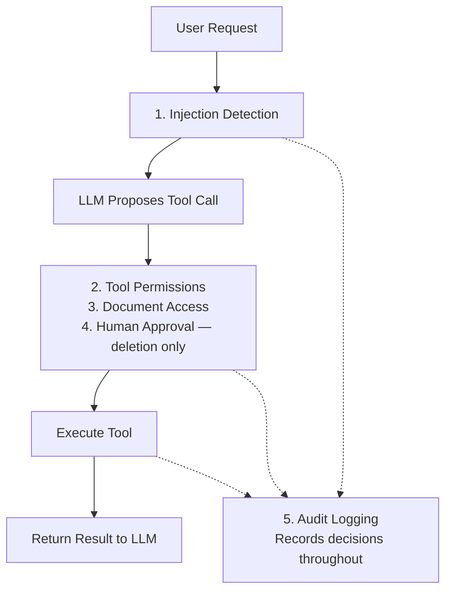

# Secure Document Agent

Simplified view of the five measures demonstrated in the video.
Human approval is required only for deletion. Failed checks block the operation or stop the response.
The implementation also screens returned document text; that additional checkpoint is omitted here for clarity.
