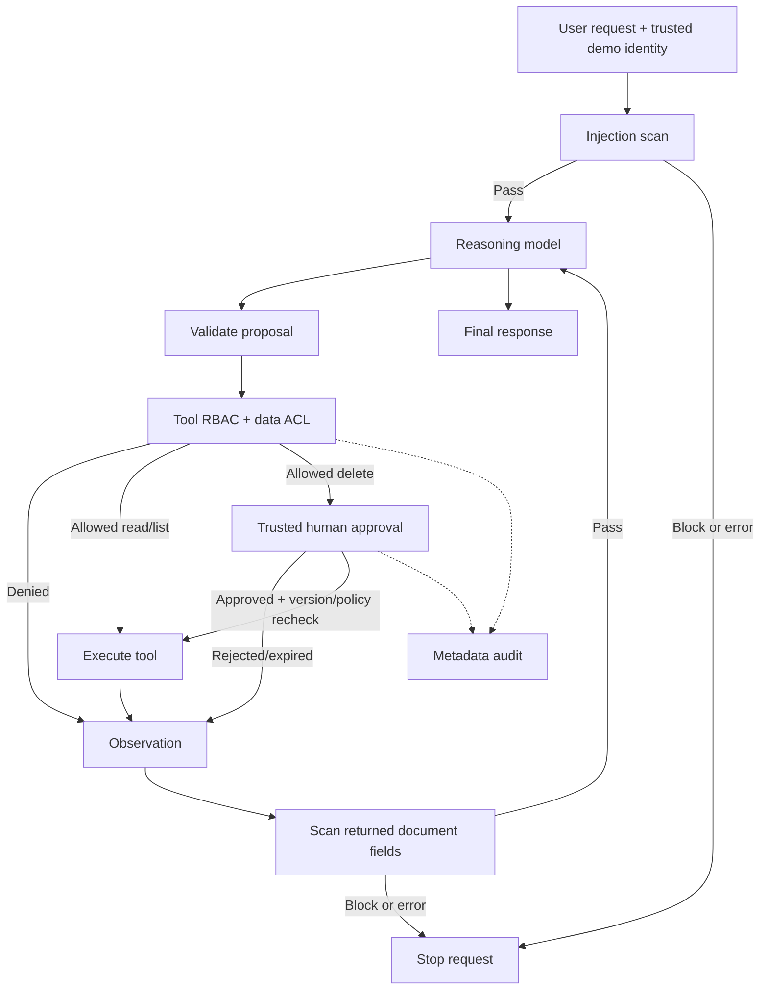

# Secure Document Agent

A security-focused AI agent project developed for CMU 14-713 HW1.

A small tool-using agent for synthetic company documents. The live mode sends a user
request to a Google model, validates its proposed tool call, enforces policy in Python,
returns the tool observation to the model, and obtains a final answer. The entire application uses Python's standard library; no third-party packages or local model weights are required. The model is a planner, not a security authority.

Video demonstration (6 min 38 sec): [Watch the demo](https://drive.google.com/file/d/1TDbD11sbdi3acVjOZdYx2DrsqBZ4v9aS/view?usp=sharing).

## Quick start

Requires Python 3.10+ and a terminal. Run every command from this directory.

```powershell
python -m unittest discover -s tests -v
python -m secure_agent --demo
```

These commands work without internet, an API key, or third-party dependencies.
**The offline demo uses a scripted test double, NOT an LLM.** It proves policy
enforcement under fixed/adversarial decisions; it does not prove live model behavior.
Simulated approvals are clearly labeled and are used only by the offline test harness.

For the actual LLM-driven agent:

```powershell
python -m secure_agent --user alice --query "Read eng-roadmap and summarize it."
python -m secure_agent --user carol
```

Keys are read from `GOOGLE_API_KEY`, then `GEMINI_API_KEY`, then optional Windows
DPAPI local storage. Otherwise, hidden terminal input is used without saving it.
On Windows, run `python configure_key.py` once to save a key encrypted for your
current Windows user in `runtime/google_api_key.dpapi`. The file is excluded from the submission ZIP and
will not work under another Windows account. Use the ordinary user terminal;
restricted service/sandbox accounts may not have access to the user's DPAPI profile.
Obtain your own key from Google AI Studio when running a fresh copy.

The default model is `gemma-4-26b-a4b-it`, validated on 2026-09-18. The course's
`gemma-3-12b-it` was not listed by the API for this account. Google lists Gemma 4
input/output as free of charge on its [pricing page](https://ai.google.dev/gemini-api/docs/pricing).
Availability and quota depend on the account; choose an accessible text model with
`--model MODEL_ID`. Do not put an API key in code, the README, or a command
line argument. Only synthetic data should be used: live requests and authorized
document observations are sent to Google's API.

The demonstrated rules mainly cover English, with a few explicit Chinese patterns. Use exact IDs for a
predictable demo, e.g. `Read handbook`, `List documents`, `Delete eng-roadmap`.
Each request has a fresh conversation history. `/quit` exits. Deleted documents
remain deleted within this process, but restarting restores the synthetic fixtures.
No host filesystem document is deleted.

If the model/API fails or emits malformed JSON, the run stops with `model_error`.
There is **no silent offline fallback**. Check your key, model access, quota and
connection; an API failure is not a successful live demonstration. Generated final
text can be inaccurate; the returned `observations` and actual store state are the
evidence of tool outcomes. A model may refuse an attack before proposing a tool;
the offline adversarial tests deliberately force proposals to test the enforcement.

## Trusted identities and policy

`--user` is a trusted classroom simulation of a server-authenticated identity. It is
not a password/login system, and authentication is not claimed as a security measure.
Someone controlling the local CLI can select any demo account. A production server
must replace this boundary with authentication and server-owned roles.

| User | Role | Department | List/read | Delete |
|---|---|---|---|---|
| alice | employee | engineering | Public + engineering | Never |
| bob | employee | finance | Public + finance | Never |
| carol | admin | engineering | Public + engineering | Accessible documents, after human approval |

Admin status does not bypass department access. `handbook` is public;
`eng-roadmap` and `injected-note` are engineering documents; `finance-budget` is
finance-only; `hr-private` is HR-only and unavailable to all three demo users.
Unknown classifications/roles default to deny. Inaccessible and nonexistent IDs
produce the same response. Listing filters IDs and titles as well as contents.

## Security controls and evidence

The three base measures are **tool RBAC, data ACL, and human-in-the-loop**.
Metadata-only auditing and prompt-injection detection are the two additional
implemented measures, giving five categories in total.

| Measure | Threat | Enforcement | Evidence |
|---|---|---|---|
| 2. Tool RBAC | A user/injected model calls a privileged tool | `tool_allowed()` before any operation | Employee deletion denied, state unchanged |
| 3. Data ACL | Cross-department disclosure or deletion | `data_allowed()` before returning metadata/content or mutating data | Cross-department read denied; filtered listing; admin ACL test |
| 4. Human approval | Destructive action without informed approval | Terminal displays operation and exact ID; `yes` or `approve` confirmation (case-insensitive; surrounding whitespace ignored); expiring one-shot approval bound to user/run/action/record fingerprint | Reject, missing approval, expiry, substitution, changed record, replay and success tests |
| 1. Prompt-injection detection | Malicious user text or instructions in retrieved documents | Standard-library pattern rules before the first LLM call and before document observations enter its transcript; a match blocks; scanner errors stop the run | `guard_results.json`: production rules and scripted-loop integration; limitations documented |
| 5. Audit logging | Missing accountability or sensitive logging | Allowlisted metadata only; no query/body/model response/key/document ID persisted | Audit privacy test and JSONL evidence |

An LLM cannot submit `approved`, a user identity, or an arbitrary path as a tool
argument. Strict schemas reject extra fields and unknown tools. There are no shell,
network-fetch, email, or arbitrary filesystem tools. Six reasoning steps per request
and a 240-second budget checked around model calls limit looping; each HTTP request
has a 30-second timeout. Human approval expires after 120 seconds. Terminal input
itself is blocking: expiry is checked when the human responds, not by interrupting
the terminal. These bounds are not a hard wall-clock termination guarantee.

The injected note tests a malicious tool observation. A scripted model deliberately
obeys its malicious instructions; the tool/data policies still block the unauthorized
operations. These legacy tests deliberately stub the detector to test containment
when screening misses an attack. Real detector evidence is separate in `guard_results.json`.
No NER capability or universal injection resistance is claimed.

## Injection detector and reproducibility

Only Python 3.10+ is needed. No pip install, conda setup, Hugging Face download,
PyTorch, or Transformers is used. Existing packages and old runtime caches are not
read by the detector. Run `python verify_guard.py` to reproduce its checks offline.
For a stronger environment check, run `python -S verify_guard.py`; `-S` disables
site packages. Live Google reasoning still needs your own API key and internet.

`guardrails.py` uses `re` and `unicodedata`. Rules detect explicit instruction
replacement, administrator impersonation, approval bypass, secret requests, and
forged system/developer message markers. Text is normalized for case, whitespace,
Unicode compatibility forms and invisible formatting characters. The full supported
text is scanned, including its tail; over 32,000 characters fails closed. Matching
any rule returns `injection_blocked`. Scanner errors stop the run with `guard_error`.
There is no probabilistic confidence score and no trained classifier.

User requests are screened before Gemma. Authorized document IDs, titles and contents
are screened before they enter the model transcript. Trusted gateway status codes
are excluded. This does not replace RBAC, ACL or terminal approval. Ordinary commands
such as `Read injected-note` and `Delete eng-roadmap` pass screening; the requested
action must still pass policy, and the retrieved injected note is blocked.

Evidence contains eight functional examples and three integrations with the production
rule detector and a scripted reasoning model. It also records benign regression
probes and known limitations. Rules can miss paraphrases, encodings and other languages;
quoting a matched attack phrase can produce a false positive. This is narrow pattern
screening, not semantic understanding or universal jailbreak protection.

## Architecture and agent tree

```text
Trusted CLI (fixed demo identity; real API key kept out of model context)
  +-- per-request Agent (fresh transcript; step/time limits)
       +-- local injection guard: user request before first model call
       +-- Google reasoning model (untrusted action proposals)
       +-- strict JSON/schema validation
       +-- ToolGateway (trusted enforcement)
       |    +-- tool RBAC
       |    +-- record/listing data ACL
       |    +-- delete only: trusted terminal approval + policy/version recheck
       |    +-- list_documents / read_document / delete_document
       |         +-- in-memory synthetic DocumentStore
       +-- authorized document fields -> local injection guard -> model -> final answer
  +-- metadata-only AuditLog across decisions
```



## Project map

- `secure_agent/agent.py`: bounded action/observation loop and per-run context.
- `secure_agent/guardrails.py`: standard-library rule detector, normalization and observation text extraction.
- `secure_agent/models.py`: Google REST adapter, output parser, offline test double.
- `secure_agent/credentials.py`: optional Windows current-user DPAPI credential storage.
- `secure_agent/security.py`: identity fixture, schemas, policy, approval tickets, audit.
- `secure_agent/tools.py`: enforcement gateway and in-memory document store.
- `secure_agent/__main__.py`: CLI and trusted human approval interaction.
- `secure_agent/demo.py`: nine deterministic allowed/blocked/attack scenarios.
- `data/documents.json`: synthetic documents including an injection fixture.
- `tests/`: security invariants and mocked HTTP adapter contract tests.
- `DEMO.md`: live demonstration steps and evidence interpretation.
- `AI_USAGE.md`: AI assistance disclosure and sources.
- `configure_key.py`: save a local key using hidden input and Windows encryption.
- `live_verify.py`: explicit live model tests, with simulated approval callbacks.

## Reproduce evidence and package

```powershell
python verify.py
python verify_guard.py
python package_submission.py
```

`verify.py` runs tests and the offline demo with Python's site packages disabled,
writes `evidence/test_results.txt`, `offline_demo_results.json`, and
`offline_audit.jsonl`, and fails if a check fails. The package command creates
`dist/HW1_secure_document_agent_D1.zip` with a top-level README and an explicit file
allowlist. It excludes runtime logs, caches, virtual environments and secrets.
The offline evidence remains labeled offline/mocked. `evidence/live_results.json`
separately records five successful real-model cases on 2026-09-18 using
`gemma-4-26b-a4b-it`: authorized read, data denial, tool denial, approval rejection,
and approval acceptance. Each involved two model calls; approvals in this test
were supplied by the harness, not a human. The normal CLI was also checked using
the encrypted local key and a real handbook read/summary. The linked recording shows a real terminal
human-approval interaction; see DEMO.md for its exact request sequence. Reproduce live checks with
`python live_verify.py`; this uses API quota and is not part of offline verification.

## Scope and limitations

- Trusted host/process/fixture files: ACLs protect the agent interface, not against
  someone editing Python, reading fixture files directly, or replacing demo identities.
- Single process and sequential execution. Fingerprint rechecks protect changes during
  approval here; a concurrent server needs transactional/atomic check-and-delete.
- Memory-only synthetic documents, no document encryption-at-rest claim and no persistent user memory.
- Optional DPAPI protects only the local API credential, not the document fixtures,
  and is not counted as a fifth assignment security category. Programs running as
  the same Windows user can decrypt it; it is not protection against host compromise.
- Logs use demo account IDs and omit payloads. They are not tamper-proof; host file
  permissions, retention and a protected logging backend remain deployment work.
- Pre-execution audit failures stop deletion. A disk failure after the mutation may
  prevent the completion log; no transactional logging/rollback guarantee is claimed.
- Permitted content can influence or confuse the model. Authorization and human
  review reduce impact but cannot guarantee truthful answers or prevent all misuse.

Future priorities: (1) real authentication and tenant-scoped sessions, (2) evaluated semantic
injection screening with reproducible optional dependencies,
(3) transactional persistent storage with encryption and protected audit retention.

## Sources and AI disclosure

1. Course: `14713_HW1_F26.pdf`, especially Student Deliverables and Clarifications.
2. Course Exercise 2 (`...protection_and_access_control_with_prompts.ipynb`):
   server-context identity, tool RBAC, and record-level authorization patterns.
3. Course Exercise 3 (`...guardrails_gemma.ipynb`): prompt-based JSON tool selection
   for Gemma and treatment of security checks as separate nodes, with a rule-based injection check in this implementation.
4. [Google generateContent API](https://ai.google.dev/api/generate-content): REST request/response contract.
5. [Python unittest documentation](https://docs.python.org/3/library/unittest.html),
   [urllib.request](https://docs.python.org/3/library/urllib.request.html), and
   [secrets](https://docs.python.org/3/library/secrets.html): standard-library APIs.
6. OpenAI Codex: AI-assisted implementation, tests and documentation; see
   `AI_USAGE.md` for prompts and adopted outputs. Copy the disclosure into the
   writeup references and update it for subsequent assistance.

This project is original generated coursework code based on the described patterns,
not a copied complete secure-agent project. The student must review it, understand
the controls, verify the live run, and take responsibility for correctness/security.
