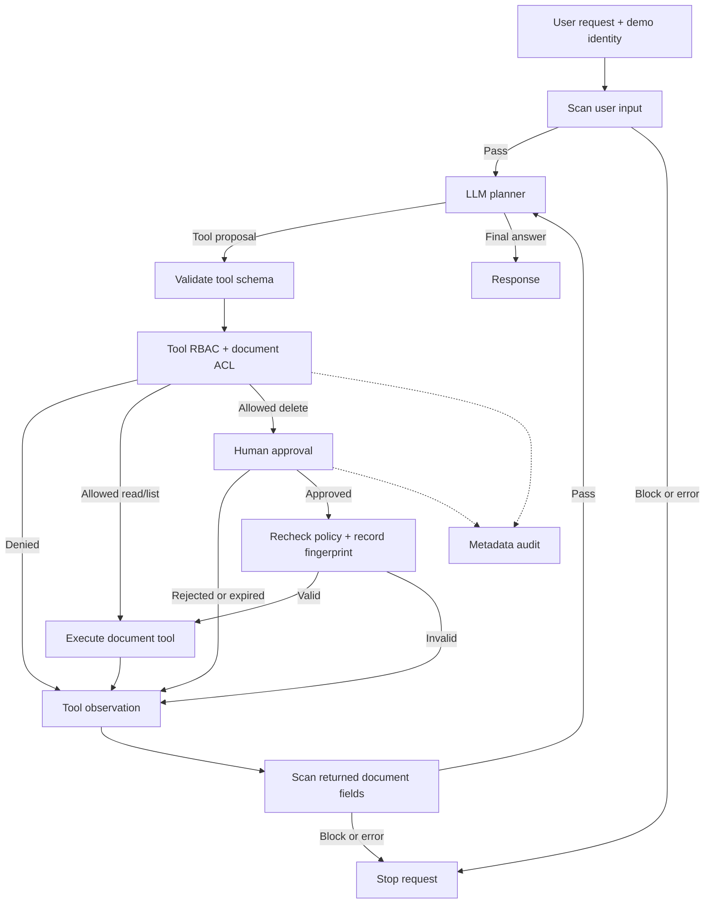

# Secure Document Agent

A Python AI agent that reads, summarizes, and manages synthetic internal documents through a controlled tool interface. It combines LLM-driven planning with explicit authorization, human approval, and privacy-conscious auditing.

**Core design principle:** the model proposes actions; application code decides whether they can run.

[Watch the demo](https://drive.google.com/file/d/1TDbD11sbdi3acVjOZdYx2DrsqBZ4v9aS/view?usp=sharing) · [Demo walkthrough](DEMO.md) · [Security tests](tests/)

## What it does

- **Natural-language document access:** list accessible documents, read a document, and ask the model to summarize it.
- **Controlled deletion:** only an authorized administrator can delete an accessible document, after explicit terminal approval.
- **Department-aware access:** filter document IDs, titles, and contents according to the caller's role and department.
- **Injection screening:** inspect user requests and retrieved document fields before they enter the model conversation.
- **Auditable decisions:** record allowlisted event metadata without persisting prompts, document bodies, model responses, API keys, or document IDs.
- **Reproducible offline demo:** exercise allowed actions, denied actions, and adversarial proposals without an API key.

The runtime uses **Python 3.10+ and the standard library only**. Live reasoning uses Google's `generateContent` API; no third-party Python packages or local model weights are required.

## Security design

Security decisions are enforced outside the model, at the boundary between proposed actions and document operations.

| Control | Implementation | Security purpose |
|---|---|---|
| Strict tool schemas | Validate tool names and arguments; reject unknown tools and extra fields | Prevent the model from supplying an identity, an approval flag, or an arbitrary path |
| Role-based tool access | Check permissions before executing an operation | Prevent employees from using administrator-only deletion |
| Document access control | Check classification and department before exposing metadata, content, or modifying a record | Prevent cross-department access, including by administrators |
| Human approval | Require a one-shot, expiring approval bound to the user, run, action, and record fingerprint; recheck policy and record state | Prevent approval replay, record substitution, and unapproved deletion |
| Prompt-injection screening | Normalize text and scan both requests and authorized document fields; block on a match or scanner error | Catch explicit instruction overrides, role impersonation, approval bypass, secret requests, and forged message markers |
| Metadata-only audit | Persist only an allowlist of decision metadata; stop deletion if pre-execution auditing fails | Support investigation while minimizing sensitive log content |

Unknown roles and classifications default to deny. Inaccessible and nonexistent document IDs return the same response. The tool interface exposes only `list_documents`, `read_document`, and `delete_document`; it provides no shell execution, arbitrary filesystem access, or network-fetch tool.

### Bounded execution and failure handling

Each request starts with a fresh model conversation. The loop allows up to six reasoning steps, checks a 240-second budget around model calls, and uses a 30-second HTTP timeout. Invalid model output or API errors stop the request with `model_error`; live mode never silently switches to the offline demo.

Approval expires after 120 seconds. The terminal displays the operation and exact document ID; `yes` or `approve` confirms it. Input is blocking, so expiry is checked when the user responds. These limits are not a hard wall-clock termination guarantee.

## Architecture



The `Agent` manages the reasoning loop. `ToolGateway` owns authorization and execution, while `DocumentStore` holds synthetic in-memory records. Model output is treated as an untrusted proposal throughout the workflow.

## Quick start

Clone the repository and run commands from its root:

```bash
git clone https://github.com/letianz3/secure-document-agent.git
cd secure-document-agent
python -m unittest discover -s tests -v
python -m secure_agent --demo
```

No installation step, network connection, or API key is needed for these commands. **The offline demo uses a scripted model test double**, so it demonstrates policy enforcement under fixed and adversarial decisions, not live LLM performance.

### Run with a live model

```bash
python -m secure_agent --user alice --query "Read eng-roadmap and summarize it."
python -m secure_agent --user carol
```

The CLI reads `GOOGLE_API_KEY`, then `GEMINI_API_KEY`, then optional Windows DPAPI storage. If no key is configured, it prompts for hidden input without saving it. On Windows, `python configure_key.py` can store a key encrypted for the current Windows user; the local credential file is ignored by Git.

The configured default model is `gemma-4-26b-a4b-it`. Use `--model MODEL_ID` to select a model available to your Google API account. Live mode requires your own key, model access, and network connectivity. Requests and authorized document observations are sent to Google's API, so use the supplied synthetic data.

Try `List documents`, `Read handbook`, or `Delete eng-roadmap`. Enter `/quit` to exit interactive mode. Deletion changes only the in-memory store; restarting restores the fixtures and no host filesystem document is deleted.

### Example access policy

| Demo identity | Role | Department | Can list/read | Can delete |
|---|---|---|---|---|
| `alice` | Employee | Engineering | Public + engineering documents | No |
| `bob` | Employee | Finance | Public + finance documents | No |
| `carol` | Administrator | Engineering | Public + engineering documents | Accessible documents, with approval |

For example, Alice can read `eng-roadmap` but cannot read `finance-budget` or delete any document. Carol can request deletion of `eng-roadmap`, but cannot bypass department restrictions. Reading `injected-note` exercises screening of malicious instructions inside retrieved content.

`--user` selects a trusted demo identity; it is not authentication. A deployed service would need authenticated sessions and server-owned roles.

## Verification

The test suite covers role and document permissions, approval rejection and expiry, replay and substitution attempts, audit privacy, injection screening, terminal approval, and mocked provider contracts.

```bash
# Run the security and adapter tests without site packages
python -S -m unittest discover -s tests -v

# Reproduce offline test/demo evidence
python verify.py

# Verify the production rule detector and scripted-loop integrations
python -S verify_guard.py
```

Generated results are stored in [`evidence/`](evidence/). Some containment tests deliberately bypass the detector to verify that authorization still blocks unsafe tool proposals when screening misses an attack. Detector checks separately exercise the production rules and include benign probes and known limitations.

Optional live checks use `python live_verify.py` and consume API quota. Their approval callbacks are simulated by the harness; they do not demonstrate a human approving a request. The [video demo](https://drive.google.com/file/d/1TDbD11sbdi3acVjOZdYx2DrsqBZ4v9aS/view?usp=sharing) shows terminal approval interaction.

## Project structure

| Path | Responsibility |
|---|---|
| [`secure_agent/agent.py`](secure_agent/agent.py) | Bounded action/observation loop |
| [`secure_agent/tools.py`](secure_agent/tools.py) | Enforcement gateway and document store |
| [`secure_agent/security.py`](secure_agent/security.py) | Identity fixtures, schemas, policy, approval tickets, and auditing |
| [`secure_agent/guardrails.py`](secure_agent/guardrails.py) | Text normalization and rule-based injection screening |
| [`secure_agent/models.py`](secure_agent/models.py) | Google API adapter, response parser, and offline model double |
| [`secure_agent/credentials.py`](secure_agent/credentials.py) | Optional Windows DPAPI key storage |
| [`secure_agent/__main__.py`](secure_agent/__main__.py) | CLI and human approval interaction |
| [`data/documents.json`](data/documents.json) | Synthetic documents and injection fixture |
| [`tests/`](tests/) | Security invariants and adapter tests |

## Scope and next steps

This is a security-focused prototype with explicit boundaries:

- **Rule-based screening:** normalization and pattern matching can miss paraphrases, encodings, and other languages, and may reject benign quotations. It is not a learned classifier or a guarantee against prompt injection.
- **Trusted local host:** controls protect the agent interface, not against someone editing the code, fixtures, or demo identities. DPAPI protects the stored API credential, not the documents or a compromised user account.
- **In-memory, sequential execution:** records are not persistent or encrypted at rest. A concurrent service needs transactional authorization and deletion.
- **Audit durability:** logs are not tamper-proof. A failure after a mutation may prevent its completion log; transactional logging and rollback are not implemented.
- **Model reliability:** authorized content can still influence the model, and final answers can be inaccurate. Tool observations and store state provide evidence of actual operations.

Next steps include authenticated, tenant-scoped sessions; transactional persistent storage; protected audit retention; and evaluated semantic injection detection alongside deterministic authorization.

## Acknowledgments

Implementation, tests, and documentation were developed with AI assistance. See [AI_USAGE.md](AI_USAGE.md) for provenance and sources.
